# Kaxe

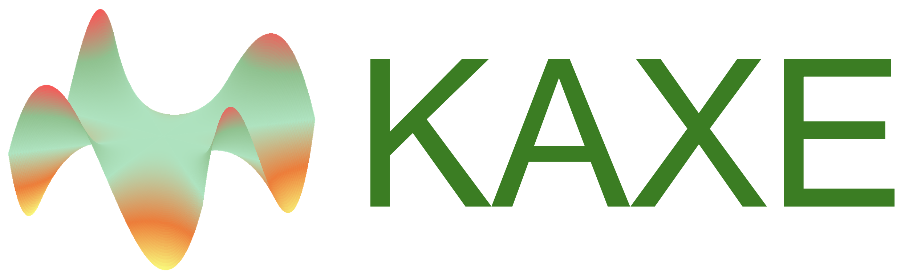

Kaxe is a lightweight, pure-Python plotting library for publication-quality figures in LaTeX documents. Create plots and charts with a simple object-oriented API, style them for A4 pages, and export to PNG or SVG.

Documentation: [kaxe.readthedocs.io](https://kaxe.readthedocs.io/en/latest/)

## Installation

```bash
pip install kaxe          # 2D plotting (default)
pip install kaxe[viewer]  # add interactive desktop viewer (pyglet)
pip install kaxe[3d]      # add 3D plotting (OpenGL)
pip install kaxe[pdf]     # add PDF export
```

## Quick example

```python
import kaxe

plt = kaxe.Plot([-5, 5, -5, 5])
plt.add(kaxe.Function2D(lambda x: x**2 - 4))
plt.add(kaxe.Points2D([1, 2, 3], [1, 4, 9]))
plt.theme(kaxe.Themes.A4Medium)
plt.title("$x^2 - 4$")
plt.show()                # streams to viewer if open, or opens system viewer
plt.save("figure.png")
plt.save("figure.svg")
```

## Interactive Plot Viewer (Infinite Canvas)

Kaxe includes a dedicated, lightweight OpenGL workspace powered by [pyglet](https://pyglet.org) so you can arrange, inspect, and compare multiple plots on an infinite canvas without cluttering your desktop with preview windows.

1. **Start the viewer** in a terminal:
   ```bash
   kaxe viewer
   ```
2. **Tag and show your plots**:
   ```python
   # Tag plots with an ID to manage them on the board:
   plt1 = kaxe.Plot().id("loss").title("Training Loss")
   plt1.show()

   plt2 = kaxe.Plot().id("accuracy").title("Validation Accuracy")
   plt2.show()
   ```

When the viewer is open, `.show()` instantly streams plots to cards on your canvas. If you re-run code with the same ID, the card updates in-place and preserves previous runs as versions (`v1`, `v2`, etc.). If the viewer is closed, `.show()` automatically falls back to your operating system's default viewer.

**Canvas & Card Controls:**
* **Click & Drag on a Card**: Move that card freely across the canvas
* **Click & Drag on Empty Space**: Pan the camera across the workspace
* **Two-Finger Scroll / Trackpad**: Pan canvas side-to-side and up/down without zooming
* **`[Shift]` + Scroll**: Pan horizontally (for 1D mouse wheels)
* **`[Cmd]` / `[Ctrl]` + Scroll**: Smooth zoom anchored to cursor
* **`[A]`**: Auto-arrange all cards in a neat row
* **`[Space]` or `[R]`**: Fit all cards on the canvas into view
* **`[1]`**: View canvas at 100% native pixel scale
* **`[←]` / `[→]`**: Cycle through versions (`v1`, `v2`, ...) of the selected card
* **`[Backspace]` / `[Delete]`**: Remove the selected card from the board
* **`[C]`** *(or Cmd/Ctrl+C)*: Copy selected plot to system clipboard
* **`[S]`** *(or Cmd/Ctrl+S)*: Save selected plot to timestamped PNG
* **`[H]`**: Toggle status & shortcuts HUD


See the [getting started guide](https://kaxe.readthedocs.io/en/latest/pages/start.html), [recipes](https://kaxe.readthedocs.io/en/latest/pages/recipes.html), [styling guide](https://kaxe.readthedocs.io/en/latest/pages/styling.html), and [export guide](https://kaxe.readthedocs.io/en/latest/pages/export.html) for the full API.

## Goals

Kaxe was made to create simple, aesthetic graphs for articles, reports, and other academic work in LaTeX:

* Plots that fit the look of LaTeX documents (Computer Modern math via [fondi](https://github.com/valteryde/fondi))
* A straightforward object-oriented interface: create a window, add objects, style, save

## Examples of plots

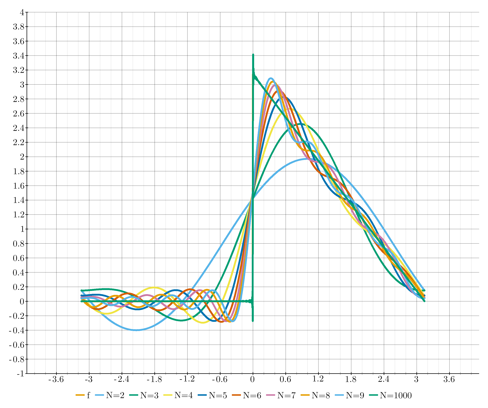
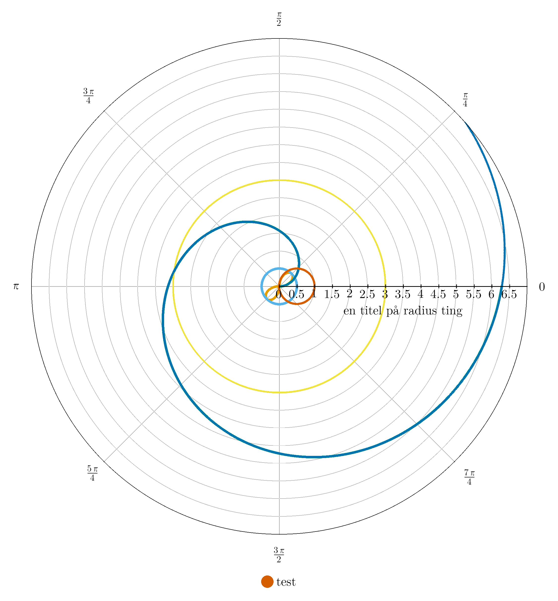
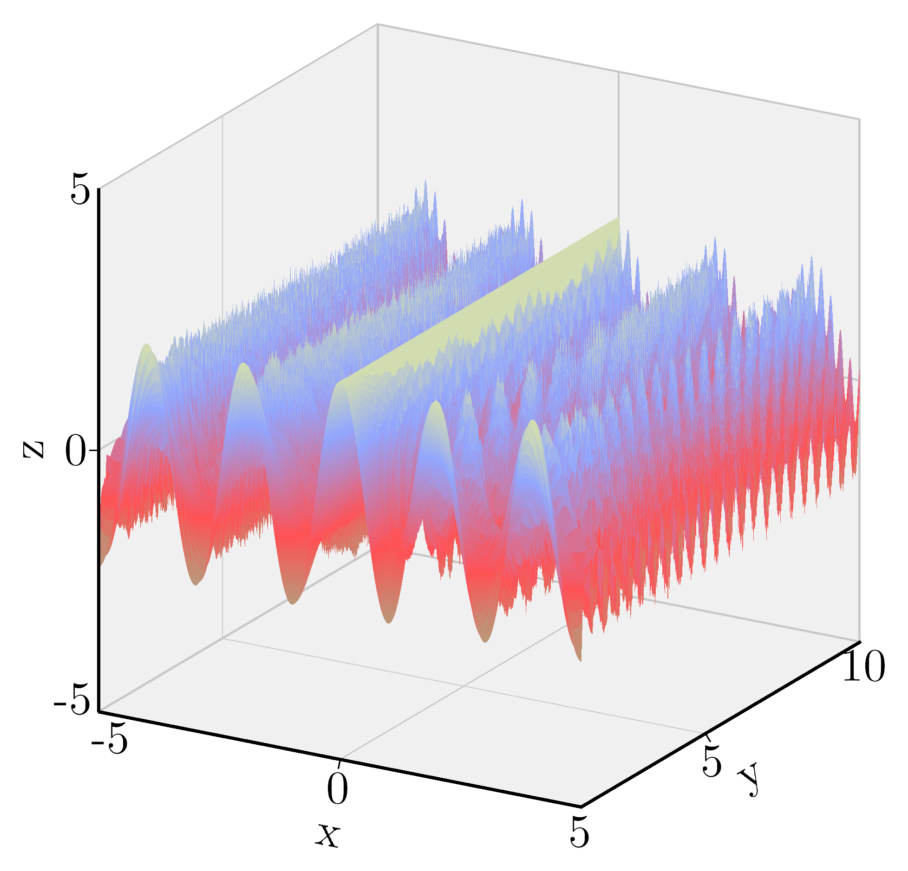
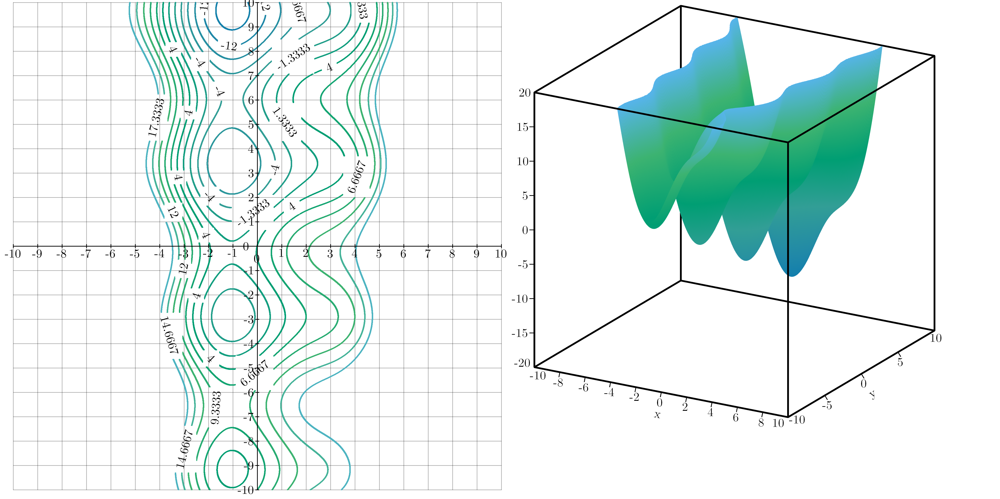
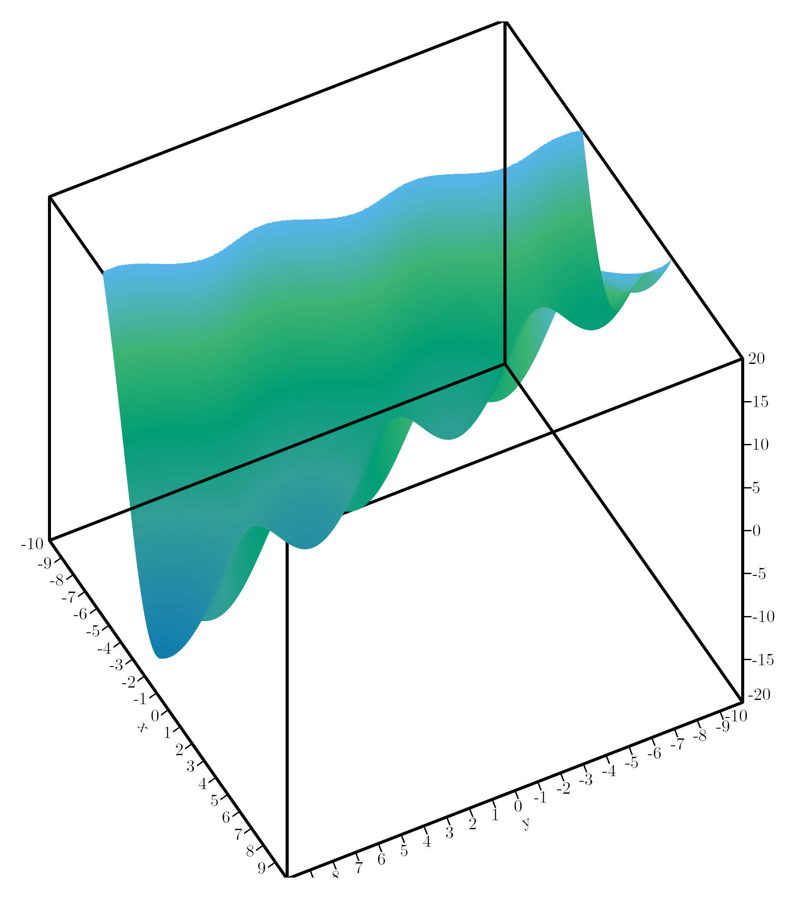
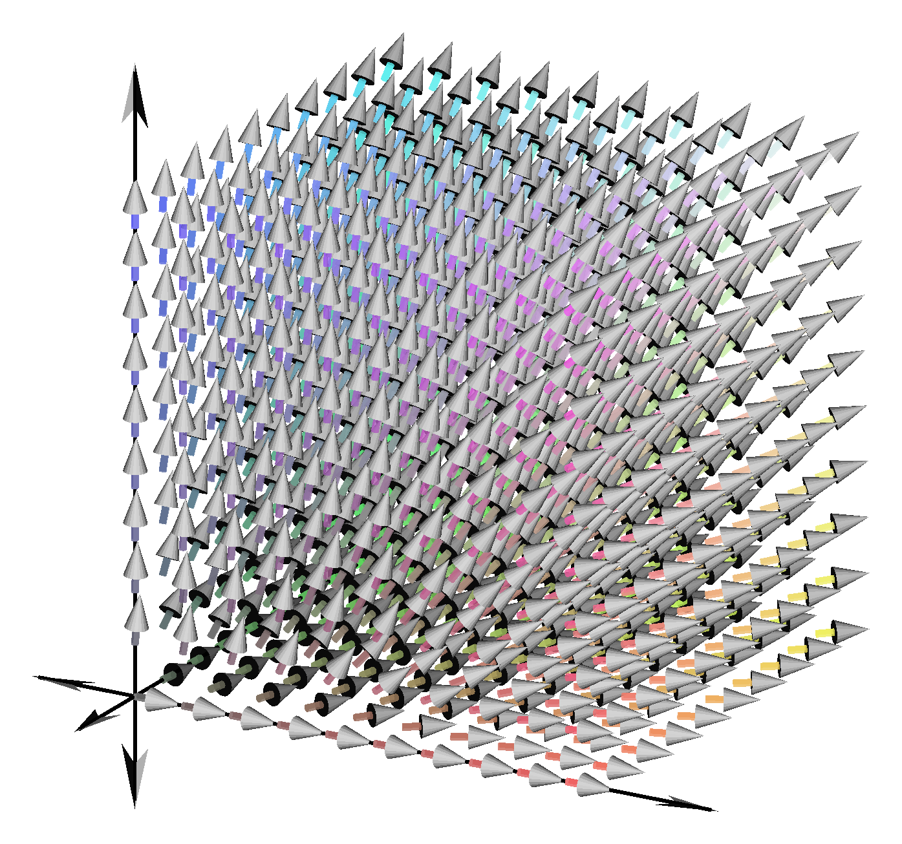
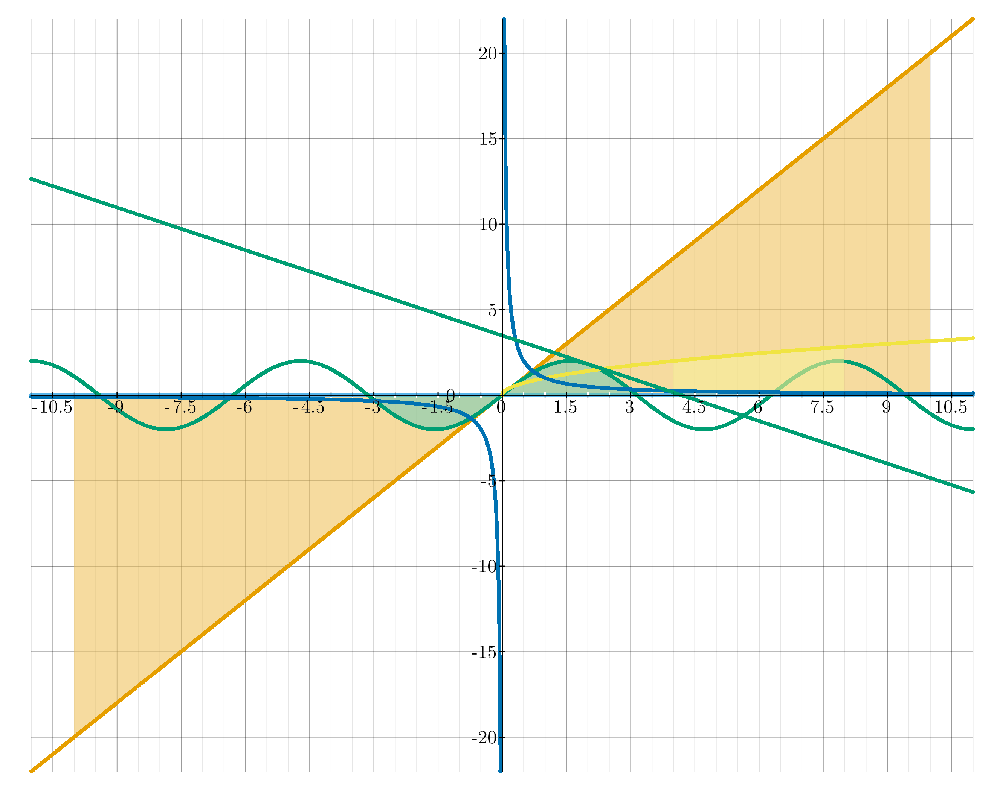
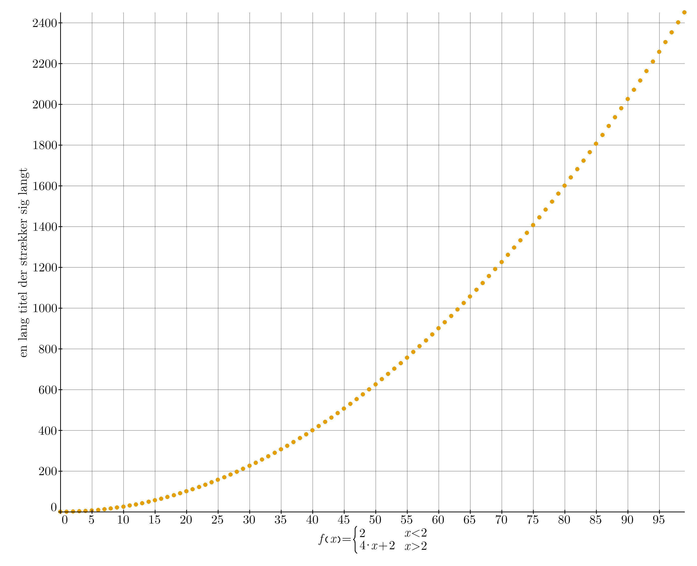
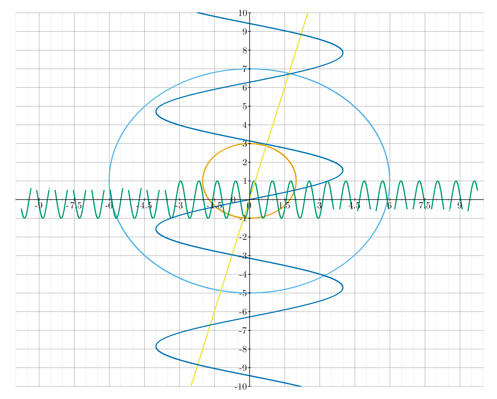
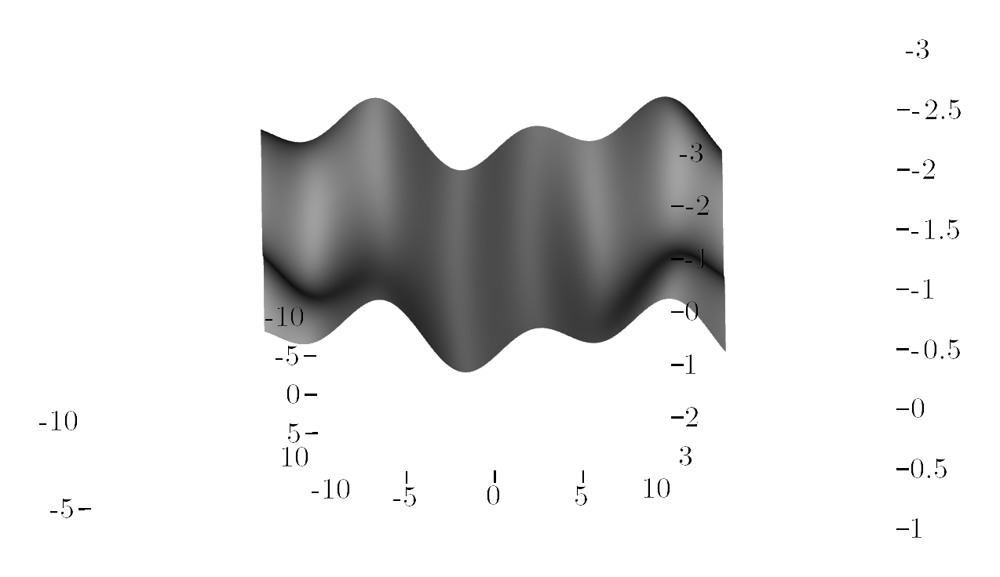
